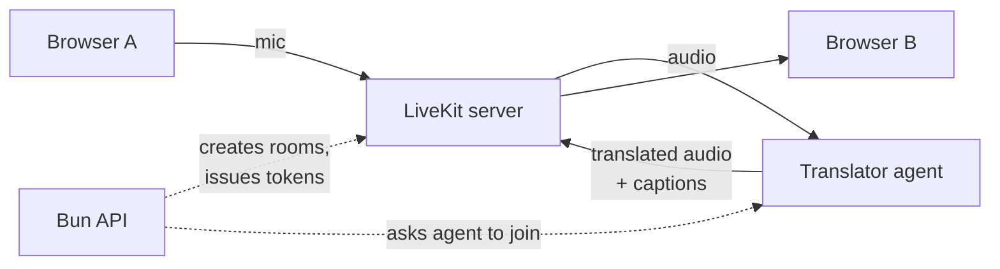

# Live Translator

A web calling app where two people speak different languages and still understand each other.
Each person talks in their own language and hears the other person in theirs, a second or two
later, with live captions on screen.

It is built for everyday conversations: a trader agreeing on a price, a family member calling
from abroad, a worker talking to a supervisor. Everything runs on open-source models on your own
machine or server. There are no paid APIs and no accounts.

**Supported calls:** Telugu ↔ English, Hindi ↔ Telugu, Telugu ↔ Mandarin

> **Status:** working MVP. Calls work end to end on a local machine (developed on an M4 MacBook
> Air). Server deployment is the next step. Expect rough edges.

## What a call looks like

1. Pick the language you speak and press **Start a call**.
2. Send the link (WhatsApp, copy, or QR code) to the other person. They open it and pick theirs.
3. Talk. You hear their words translated into your language and see captions for both sides.

Along the way:

- **Key facts** such as prices, quantities and phone numbers appear as chips (`₹2,500`,
  `98480 22338`). They come from what the speaker actually said, so they stay correct even when
  a translation gets a number wrong.
- **Repeat** plays the last translation again. **Didn't understand** asks the other person, in
  their own language, to say it again more simply.
- The original voice plays quietly underneath the translation; a slider controls its volume.
- The whole interface switches to the language you speak, so nobody needs to read English.

## How it works



A translator agent joins every call as a third, silent participant. For each person it:

1. **Listens.** Silero VAD finds speech. An adaptive endpointer decides when a sentence is
   finished. Telugu and Hindi put the verb (and "not") at the end, so it waits a little longer
   for those speakers.
2. **Transcribes** with a model chosen per language: IndicConformer for Telugu and Hindi,
   Parakeet for English, Whisper for Mandarin. A punctuation model then splits Indic text
   into sentences.
3. **Protects the facts.** Spoken numbers become digits ("ఐదు వందల రూపాయలు" becomes "500
   రూపాయలు") before translation, because translation models copy digits far more reliably
   than they translate number words.
4. **Translates** with IndicTrans2 (Indian languages), plus Opus-MT and M2M100 for Mandarin
   by way of English.
5. **Checks the translation.** It rejects a sentence that lost a number, changed a unit
   ("50 rupees a kilo" turning into "50 kilos"), came out in the wrong script, or got stuck
   repeating itself. Where a second route exists (Hindi ↔ Telugu goes via English), that
   sentence is retried once; money and numbers also get small, safe repairs.
6. **Speaks** the result with Piper (Telugu) or Kokoro (English, Hindi, Mandarin). The first
   sentence starts playing while the rest is still being synthesised.

Each listener gets their own translated audio track, and captions travel on a LiveKit data
channel. Only the agent is allowed to send captions, so the other participant cannot fake them.

## Running it locally

### What you need

- macOS on Apple silicon (the development setup). Linux should work with `PROFILE=contabo-cpu`
  but the dev scripts assume Homebrew.
- 16 GB RAM and about 15 GB of free disk for the models
- [Bun](https://bun.sh), [uv](https://docs.astral.sh/uv/) (it installs Python 3.12 for you),
  LiveKit server and PostgreSQL:

```sh
brew install livekit postgresql@17
brew services start postgresql@17
```

- A free [Hugging Face](https://huggingface.co) account. The AI4Bharat models are MIT-licensed
  but "gated": you have to log in and click *Agree* once.

### Setup

```sh
bun install
bun run setup
```

`setup` checks your tools, writes a `.env` with fresh random secrets, creates the database,
installs both Python environments and downloads the models (several GB the first time).

The first run will tell you if the gated models are not unlocked yet. To unlock them:

```sh
cd services && uv run hf auth login     # paste a "read" token from huggingface.co/settings/tokens
```

Then open these four pages, click **Agree and access repository** on each, and run
`bun run setup` again:

- https://huggingface.co/ai4bharat/indic-conformer-600m-multilingual
- https://huggingface.co/ai4bharat/indictrans2-en-indic-dist-200M
- https://huggingface.co/ai4bharat/indictrans2-indic-en-dist-200M
- https://huggingface.co/ai4bharat/indictrans2-indic-indic-dist-320M

### Start

```sh
bun run dev
```

This starts LiveKit, the translator agent, the API and the web app together. Open
<http://localhost:5173> in two browser windows (or Chrome and Safari), choose a different
language in each, and talk. Wear earphones, otherwise each window hears the other's speaker.

If the call stays on "Connecting…", the macOS firewall is probably blocking WebRTC. The first
`bun run dev` asks whether `livekit-server` and `python3.12` may accept incoming connections;
click **Allow** for both. See [docs/runbooks/local-dev.md](docs/runbooks/local-dev.md#macos-firewall)
if you clicked Deny.

## Commands

| Command | What it does |
|---|---|
| `bun run dev` | Everything, with hot reload |
| `bun run start` | Build the web app and serve it from the API, like production |
| `bun run test` | API tests and Python tests |
| `bun run lint` | Biome (TypeScript) and Ruff (Python) |
| `bun run typecheck` | TypeScript across all packages |
| `bun run db:migrate` | Apply database migrations |

The translator also has a command-line tool. Run it from `services/agent`:

```sh
uv run translator-cli translate --src te --tgt en --text "ఐదు వందల రూపాయలు ఇవ్వండి"
uv run translator-cli translate --src en --tgt te --wav sample.wav --say out.wav
uv run translator-cli bench --src en --tgt zh --wav a.wav --runs 5    # latency p50/p95
uv run translator-cli e2e --src te --tgt en --text "నేను రేపు రాను."  # a real call between two bots
uv run translator-cli eval --set ../../eval/sets/smoke-v0.json         # the full accuracy test
```

`e2e` and `eval` need `bun run dev` running. Add `--offline` to `eval` to skip LiveKit and test
models faster.

## Project layout

```
apps/
  web/              React app: language picker, call screen, captions (Vite, Tailwind)
  api/              Bun + Hono API: rooms, seats, LiveKit tokens; SQL migrations
packages/
  contracts/        Shared types and schemas (Zod) for the API and data channel
services/           Python, managed with uv
  pipeline-core/    Pure algorithms, no I/O: endpointing, numbers, key facts, checks, repairs
  agent/            Translator agent: joins LiveKit rooms, runs the models; translator-cli
  tts-worker/       Speech synthesis as a separate program (GPL code is isolated here)
config/
  languages.json    Languages and which pairs can call each other
  routes.bootstrap.json   Which model handles each language and direction
eval/
  sets/             Test sentences with expected numbers and negations
  results/          Saved runs and reviews
infra/livekit/      LiveKit config for local development
scripts/            setup and dev runners (Bun)
docs/
  runbooks/         How to run things
  adr/              Why things were built the way they are
  licences/         Licence of every model, voice and library
  plan.md           The original design plan
models/             Downloaded models (not committed)
```

## Configuration

`bun run setup` creates `.env` from [.env.example](.env.example). The settings you are most likely
to change:

| Variable | Default | Meaning |
|---|---|---|
| `DATABASE_URL` | `postgres://you@127.0.0.1:5432/live_translator` | Your local Postgres |
| `PROFILE` | `m4-local` on Apple silicon, else `contabo-cpu` | Which set of models to run |
| `MODEL_THREADS` | `4` | CPU threads per model |
| `PRELOAD_MODELS` | `0` | `1` loads every model at start-up instead of on first use |
| `LIVEKIT_NODE_IP` | unset | Your Mac's LAN IP, so phones on the same Wi-Fi can join |
| `ROOM_TTL_HOURS` | `24` | How long a call link stays valid |

## Accuracy and speed

Measured on 72 test calls covering every direction (12 sentences each, with prices, phone
numbers, dates and negations) on an M4 MacBook Air:

- **Meaning:** 61 correct, 8 understandable with a small error, 3 wrong.
- **Facts:** 36 of 37 numbers and all 18 negations came through. The one miss was a Telugu
  number word the speech recogniser misspelled; the ASR clean-up step added since then fixes it.
- **Delay** from the end of speech to the first translated audio (median): 1.2 s for
  English → Telugu, 1.3–1.4 s for Hindi → Telugu, 1.6–1.8 s from Telugu, 2.1 s for
  Mandarin → Telugu, 2.6 s for Telugu → Mandarin.

The speakers in this test were synthesised voices, so real phone-quality speech will score lower.
Testing with recorded human speech is next. Full results:
[eval/results/2026-10-15](eval/results/2026-10-15/smoke-v0-call-final-review.md).

## Privacy

- No audio and no transcripts are stored. The database only holds room ids, expiry times and
  the language of each seat.
- Logs contain timings and error codes, never what anyone said.
- A call link is a random 128-bit id that expires after 24 hours.

## Licences

Every model, voice and library was picked for a licence that allows commercial use. The full
list, with the reason each rejected model was left out, is in
[docs/licences/REGISTER.md](docs/licences/REGISTER.md).

Some models require attribution (CC-BY-4.0): NVIDIA Parakeet, Helsinki-NLP Opus-MT and the
Piper Telugu voice, which was trained on AI4Bharat IndicVoices-R.

`services/tts-worker` uses Piper and espeak-ng, which are GPL-3.0. It is therefore a separate
program with its own environment, and the agent talks to it over a pipe.

## More documentation

- [Local development guide](docs/runbooks/local-dev.md): phones on Wi-Fi, firewall, eval runs
- [Design decisions](docs/adr/0017-local-dev-and-mvp-decisions.md)
- [Design plan](docs/plan.md): model research, latency budget, roadmap and risks
